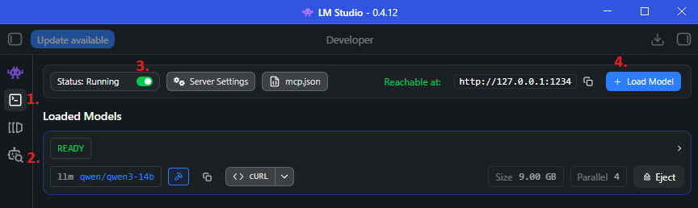
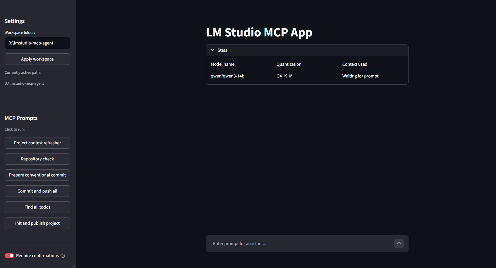

# LM Studio MCP Developer Agent

## 1. Wymagania wstępne

### A. Python

- **Windows / macOS:** [python.org](https://www.python.org/downloads/)
- **Linux:** `sudo apt update && sudo apt install python3 python3-pip python3-venv`

### B. Git (Wymagany do obsługi repozytoriów)

- **Windows:** [git-scm.com](https://git-scm.com/download/win).
- **macOS:** Terminal: `git --version` - jeśli narzędzia nie są zainstalowane, system wyświetli okno instalacji
- **Linux:** `sudo apt install git`
- _Ważne:_ Upewnij się, że Git jest skonfigurowany:
  ```bash
  git config user.name
  git config user.email
  ```

### C. GitHub CLI (`gh`) (Wymagane do tworzenia repozytoriów na GitHubie)

- **Windows:** `winget install --id GitHub.cli`
- **macOS:** `brew install gh`
- **Linux:** [Instrukcja](https://github.com/cli/cli/blob/trunk/docs/install_linux.md).
- _Ważne:_ Po instalacji trzeba zalogować się na swoje konto.
  ```bash
  gh auth login
  ```
  (Logowanie przez przeglądarkę i dalej zgodnie z instrukcjami na ekranie).

### D. LM Studio

- Instalacja ze strony [lmstudio.ai/download](https://lmstudio.ai/download).
- Upewnij się że instalujemy LM Studio, nie LM Studio Bionic.

---

## 2. Instalacja projektu

1. **Sklonuj lub pobierz to repozytorium:**

   ```bash
   git clone https://github.com/Jakyubi/lmstudio-mcp-agent
   cd lmstudio-mcp-agent
   ```

2. **Utwórz wirtualne środowisko:**
   - **Windows:**
     ```bash
     python -m venv venv
     venv\Scripts\activate
     ```
   - **macOS / Linux:**
     ```bash
     python3 -m venv venv
     source venv/bin/activate
     ```

3. **Zainstaluj wymagane pakiety Pythona:**

   ```bash
   pip install -r requirements.txt
   ```

4. **Konfiguracja zmiennych środowiskowych:**

   _Plik `.env.example` zawiera domyślne porty dla LM Studio i serwera MCP - zazwyczaj nie trzeba ich modyfikować, wystarczy zmienić nazwę na `.env`._
   - **Windows:** `copy .env.example .env`
   - **macOS / Linux:** `cp .env.example .env`

---

## 3. Konfiguracja LM Studio



- Otwórz **LM Studio**.
- W zakładce `Model Search` (2) Wyszukaj i pobierz model wspierający wywoływanie narzędzi (Tool Calling), np. `Qwen 3.5 9B`, `Qwen 3 14B` lub `gpt-oss-20b`.
- Przejdź do zakładki **Developer** (1).
- Upewnij się, że port to `1234`.
- Przyciskiem `Load Model` (4) wybieramy odpowiedni model.
- Uruchamiamy serwer (3).

---

## 4. Uruchomienie aplikacji

Aplikacja składa się z dwóch elementów, które muszą działać jednocześnie w dwóch osobnych oknach terminala.

W obu terminalach musimy aktywować wirtualne środowisko:

- **Windows:**
  ```bash
  venv\Scripts\activate
  ```
- **macOS / Linux:**
  ```bash
  source venv/bin/activate
  ```

**Terminal 1 (Serwer MCP):**
Uruchom serwer:

```bash
python mcp_server.py
```

_(Powinien pojawić się komunikat, że serwer wystartował na porcie 8000)._

**Terminal 2 (Interfejs Streamlit):**
Uruchom interfejs:

```bash
streamlit run app.py
```

_(Przeglądarka otworzy się automatycznie pod adresem `http://localhost:8501`)._

---

## 5. Instrukcja użytkowania



1. **Ustawianie obszaru roboczego (Workspace):**
   - W lewym panelu znajduje się pole _Workspace folder_.
   - Tam podajemy absolutną ścieżkę do folderu, w którym pracujemy (np. `D:/MojeProjekty/TestApp`).
   - Kliknij **Apply workspace**. Agent ma dostęp tylko do tego folderu i jego podfolderów.
2. **Prompty (Gotowe skrypty):**
   - W panelu bocznym znajdziesz gotowe przyciski (np. _Init and publish project_, _Pre commit check_).
   - Kliknięcie uruchamia przygotowany ciąg instrukcji, który poprowadzi agenta krok po kroku.
3. **Akceptacja akcji:**
   - Zaznaczona opcja **Require confirmations** sprawia, że każda potencjalnie niebezpieczna akcja agenta zatrzyma proces.
   - Na ekranie pojawi się komunikat z prośbą o akceptację lub odrzucenie.
4. **Dostępne narzędzia**
   - Pod `Require confirmations` znajduje się lista aktualnie dostępnych narzędzi

---

## 6. Troubleshooting

### Aplikacja rzuca błąd `API Connection Error: Cannot connect to LLM`

- **Przyczyna:** Streamlit nie może połączyć się z serwerem LM Studio.
- **Rozwiązanie:** Sprawdź, czy w LM Studio w zakładce _Local Server_ kliknąłeś "Start Server" i czy działa on na porcie `1234`.

### Błąd `gh command not found` lub `GitHub Repo Creation Failed`

- **Przyczyna:** Brak narzędzia GitHub CLI lub brak autoryzacji.
- **Rozwiązanie:** Otwórz zwykły terminal systemowy, upewnij się, że masz zainstalowane `gh`, a następnie wpisz `gh auth login` i zaloguj się na swoje konto GitHub.

### Agent zwraca kod w tagach XML (np. `<tool_call>`) zamiast użyć narzędzia

- **Przyczyna:** Mniejsze, lokalne modele czasem zapominają właściwego formatu wywoływania funkcji (JSON) i halucynują dziwny format tekstowy. Aplikacja zatrzyma się, podając puste okno odpowiedzi.
- **Rozwiązanie:** Wyślij na czacie wiadomość: _"Your last tool call was formatted incorrectly. Please use the standard JSON tool calling format."_ (Często wystarczy zmienić model w LM Studio na nieco większy/inteligentniejszy, dedykowany do programowania, np. Qwen Coder).

### Zmiany w plikach nie chcą się skomitować (błąd Gita)

- **Przyczyna:** Narzędzie `git_commit` wymaga, aby Git wiedział, kim jesteś.
- **Rozwiązanie:** Jeśli to świeża instalacja Gita, w terminalu wpisz:
  `git config --global user.name "Your Name"`
  `git config --global user.email "you@example.com"`

### Błąd `Port 8000 is already in use` przy starcie `mcp_server.py`

- **Przyczyna:** Prawdopodobnie inna aplikacja zajmuje port, lub poprzednia instancja serwera nie zamknęła się poprawnie.
- **Rozwiązanie:** Zabij proces używający tego portu, zresetuj komputer lub w pliku `mcp_server.py` (linia na samym dole) oraz `.env` zmień port na inny wolny.
